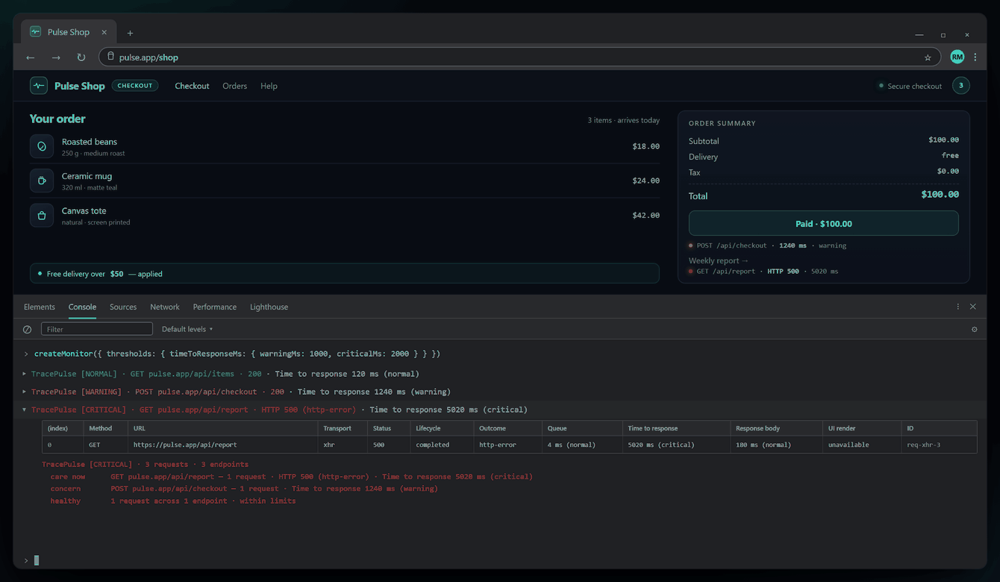

# TracePulse

**Zero-dependency, framework-agnostic request monitoring and performance observability** — fetch/XHR instrumentation, warning/critical thresholds, typed events and console reporting for browsers, Node, Deno, Bun and edge runtimes.

> **Search terms:** request monitoring · performance monitoring · observability · APM · telemetry · tracing · fetch · XHR · instrumentation · thresholds · TypeScript · zero dependencies

<p align="left">
  <a href="https://www.npmjs.com/package/@codewithrajat/tracepulse"></a>
  <a href="CHANGELOG.md"></a>
  <a href="https://www.npmjs.com/package/@codewithrajat/tracepulse"></a>
  <a href="https://www.npmjs.com/package/@codewithrajat/tracepulse"></a>
  <a href="package.json"></a>
  <a href="package.json"></a>
  <a href="vite.config.ts"></a>
  <a href="package.json"></a>
  <a href="package.json"></a>
  <a href="vite.config.ts"></a>
  <a href="docs/guide/architecture.md"></a>
  <a href="examples/ssr.md"></a>
  <a href="examples/README.md"></a>
  <a href="docs/guide/architecture.md"></a>
  <a href="docs/guide/api.md"></a>
  <a href="examples/README.md"></a>
  <a href="CHANGELOG.md"></a>
  <a href="https://github.com/malikrajat/tracepulse/actions/workflows/ci.yml"></a>
  <a href="https://bundlephobia.com/package/@codewithrajat/tracepulse"></a>
  <a href="./LICENSE"></a>
  <a href="https://github.com/malikrajat/tracepulse/pulls"></a>
</p>

---

## See it in action

<div align="center">
  
  <p><em>Same page, same code: three requests, with one line telling you what needs attention.</em></p>
</div>

<p align="center">
  <b>Zero-dependency request diagnostics for <code>fetch()</code> and <code>XMLHttpRequest</code>.</b><br />
  Measure the request lifecycle, classify it against warning/critical thresholds, and read the
  result in your console. No backend, no account, nothing leaves the page.
</p>

<p align="center">
  <a href="./docs/guide/getting-started.md"><b>📘 Documentation</b></a> ·
  <a href="./examples/README.md"><b>🧪 Examples</b></a> ·
  <a href="./docs/guide/architecture.md"><b>🏗 Architecture</b></a> ·
  <a href="./docs/guide/api.md"><b>🔌 API reference</b></a> ·
  <a href="#faq"><b>❓ FAQ</b></a> ·
  <a href="./CHANGELOG.md"><b>📝 Changelog</b></a>
</p>

> **Status:** `1.0.0` (unreleased). Request monitoring (fetch/XHR), threshold evaluation
> and console reporting are implemented. The generic instance logic in
> `src/core/trace-pulse.ts` remains a small reference implementation meant to be replaced.

---

## Table of contents

- [See it in action](#see-it-in-action)
- [Why TracePulse](#why-tracepulse)
- [Install](#install)
- [Quick start](#quick-start)
- [Documentation and examples](#documentation-and-examples)
- [Monitor requests](#monitor-requests)
- [Configuration](#configuration)
- [Measurement model](#measurement-model)
- [The toolchain (Vite+)](#the-toolchain-vite)
- [Core concepts](#core-concepts)
- [Recipes](#recipes)
- [API](#api)
- [Package formats](#package-formats)
- [Requirements](#requirements)
- [Project structure](#project-structure)
- [Development](#development)
- [Publishing](#publishing)
- [FAQ](#faq)
- [Support](#support)
- [License](#license)

## Why TracePulse

- **Framework-agnostic.** No Vue, React, DOM or Node.js APIs in the core. Works in
  browsers, web workers, Node, Deno, Bun and edge runtimes.
- **Zero dependencies.** `dependencies` is empty; the published tarball contains only
  your code.
- **Tiny and optimized.** Minified ESM/CJS/IIFE bundles, `sideEffects: false`, static
  ESM exports — bundlers tree-shake it down to what you import. **~13.8 kB brotli** for
  the full request-monitoring API (configuration, console reporting and the bounded report
  store included). The HTML/JSON renderer is an opt-in subpath that adds nothing to the root.
- **Exportable reports.** One call turns a session into a self-contained HTML or JSON file
  with search, sorting, stage/owner attribution and page timing. No backend, no upload.
- **No source maps shipped.** Smaller tarball, cleaner `dist/`.
- **Strict by default.** TypeScript `strict` + `noUncheckedIndexedAccess` +
  `exactOptionalPropertyTypes`, validated runtime options and stable error codes.
- **Deterministic in tests.** Inject `clock` and `idFactory`; no hidden globals.
- **One toolchain.** [Vite+](https://viteplus.dev) (`vp`) handles dev server, lint,
  format, type-check, tests and library packing from a single `vite.config.ts` — no
  ESLint or Prettier config files.
- **Publish-ready.** Dual ESM/CJS with `.d.ts` + `.d.cts`, IIFE bundle for CDNs,
  publint/attw/size-limit checks and provenance-ready releases via Changesets.

## Install

```bash
pnpm add @codewithrajat/tracepulse
# or
npm install @codewithrajat/tracepulse
# or
yarn add @codewithrajat/tracepulse
```

> **Not published yet.** `1.0.0` is prepared but unreleased, so the commands above fail until
> the first publish. In the meantime, install straight from the repository:
>
> ```bash
> pnpm add file:../path/to/TracePulse
> # or, inside a pnpm workspace
> pnpm add "@codewithrajat/tracepulse@workspace:*"
> ```
>
> Every example imports from the package root, so switching to the published package later
> needs no code change.

## Quick start

```ts
import { createTracePulse } from '@codewithrajat/tracepulse'

const pulse = createTracePulse({ name: 'checkout', sampleRate: 0.5 })

const unsubscribe = pulse.on('pulse', (event) => {
  console.log(event.name, event.timestamp, event.data)
})

pulse.start()
pulse.pulse('render', { ms: 12 })

unsubscribe()
pulse.dispose()
```

## Documentation and examples

Both live in this repository — no external site, no login, nothing to install to read them.

### Documentation

| Guide                                                  | What it covers                                         |
| ------------------------------------------------------ | ------------------------------------------------------ |
| [Getting started](./docs/guide/getting-started.md)     | Install, first instance, everyday commands             |
| [Configuration](./docs/guide/configuration.md)         | Every setting, its default, merge rules and validation |
| [Architecture](./docs/guide/architecture.md)           | Parameters, defaults, pipeline, build and licensing    |
| [Scope and protocols](./docs/guide/scope.md)           | In-scope transports, exclusions and open decisions     |
| [API reference](./docs/guide/api.md)                   | Every export and signature                             |
| [Measurement model](./docs/guide/measurement-model.md) | Timestamps, durations, lifecycle and outcomes          |
| [Core concepts](./docs/guide/core-concepts.md)         | Lifecycle, events, history, sampling and plugins       |
| [Plugins](./docs/guide/plugins.md)                     | Extend an instance without touching internals          |
| [Migrating thresholds](./docs/guide/migration.md)      | Upgrade from single-number thresholds                  |
| [Troubleshooting](./docs/guide/troubleshooting.md)     | Common failures and their causes                       |
| [Publishing](./docs/guide/publishing.md)               | Release process and provenance                         |

### Examples

Each framework has its own folder; every page is copy-paste runnable code.

| Framework                               | Folder              | Covers                                                         |
| --------------------------------------- | ------------------- | -------------------------------------------------------------- |
| [React](./examples/react/README.md)     | `examples/react/`   | Context provider, StrictMode-safe instance, Next.js App Router |
| [Angular](./examples/angular/README.md) | `examples/angular/` | Root service, app initializer, HttpClient, zoneless and SSR    |
| [Vue](./examples/vue/README.md)         | `examples/vue/`     | Plugin, typed composable, Nuxt client plugin                   |
| [Svelte](./examples/svelte/README.md)   | `examples/svelte/`  | Context provider, `onMount`, SvelteKit guard                   |
| [Vanilla](./examples/vanilla/README.md) | `examples/vanilla/` | Module, IIFE `<script>`, demo page, Vite HMR                   |
| [Node](./examples/node/README.md)       | `examples/node/`    | Per-request instances; why not to monitor globally             |

Framework-agnostic recipes in [`examples/`](./examples/README.md):
[basic monitoring](./examples/basic-monitoring.md) ·
[exclusions](./examples/exclusions.md) ·
[thresholds](./examples/thresholds.md) ·
[console output](./examples/console-output.md) ·
[lifecycle](./examples/lifecycle.md) ·
[core events and plugins](./examples/core-events.md) ·
[testing](./examples/testing.md) ·
[SSR and workers](./examples/ssr.md).

## Monitor requests

`createMonitor()` installs `fetch()` / `XMLHttpRequest` instrumentation and reports completed
request measurements to the developer console. It starts automatically by default.

```ts
import { createMonitor } from '@codewithrajat/tracepulse'

const monitor = createMonitor({
  exclude: ['/telemetry'],
  thresholds: { timeToResponseMs: { warningMs: 1000, criticalMs: 2000 } },
})

// fetch() and XMLHttpRequest calls are reported automatically.

monitor.stop() // uninstall this monitor's instrumentation
monitor.start() // reinstall; repeated calls are safe
```

- `enabled: false` never starts; `autoStart: false` waits for an explicit `start()`.
  `enabled` is fixed at creation — V1 has no runtime toggle.
- `start()` / `stop()` are idempotent. Only one monitor may run per loaded module
  instance; a competing `start()` throws `TracePulseError` with code `INVALID_STATE`.
  The guard belongs to the loaded module instance, so duplicate copies of the package or
  separate realms are not globally coordinated.
- `stop()` never cancels in-flight requests: they settle normally but are no longer
  observed, so no terminal report is produced after stopping.
- `stop()` leaves a third-party `fetch` / XHR wrapper installed after TracePulse untouched.
  Restarting wraps the current patch and does not duplicate reports.
- `console.enabled`, `console.level`, `console.useColors`, `console.showTable` and
  `console.collapsible` control reporter output. `console.level` is a minimum severity:
  `all` (default), `warning`, `critical` or `off`, so production can hide healthy requests
  without disabling monitoring. By default each terminal request becomes one **collapsed
  console group**: expanding it shows that request's row (`Queue`, `Time to response`,
  `Response body`, `UI render`) and the colour-coded session summary. The console stays one
  line per request instead of reprinting a growing table, and any timing increase over the
  previous sample of the same endpoint is highlighted in the group header.
- `console.replace: true` switches to the single-table mode: the console is cleared before
  printing the complete accumulated table (it also clears your application's own output).
- `console.panel: true` renders the same session in a collapsed **in-page panel** that is
  updated in place: one row per request occurrence, the session summary and the page report,
  with the console left completely untouched.
- See the [API reference](docs/guide/api.md#request-monitoring) for the lifecycle contract.

## Configuration

Monitoring is configured with a single typed object. `resolveConfig()` merges partial
overrides with `DEFAULT_CONFIG` (deeply frozen), validating everything on the way.

```ts
import { resolveConfig } from '@codewithrajat/tracepulse'

const config = resolveConfig({
  exclude: ['https://analytics.example.com', '/telemetry'],
  thresholds: { timeToResponseMs: { warningMs: 1500 } },
  console: { showTable: false },
})

config.thresholds.timeToResponseMs.warningMs // 1500
config.thresholds.timeToResponseMs.criticalMs // 3000 — default preserved
config.thresholds.responseProcessingMs.criticalMs // 500 — default preserved
config.colors.warning // "#eab308" — default preserved
```

| Group        | Settings                                                                                                     | Defaults                                                           |
| ------------ | ------------------------------------------------------------------------------------------------------------ | ------------------------------------------------------------------ |
| General      | `enabled`, `autoStart`                                                                                       | `true`, `true`                                                     |
| `exclude`    | URLs your app calls that should not be measured                                                              | `[]`                                                               |
| `thresholds` | `queueMs`, `timeToResponseMs`, `responseProcessingMs`, `uiUpdateMs`, each a `{ warningMs, criticalMs }` pair | `100/300`, `2000/3000`, `300/500`, `500/1000` ms                   |
| `ownership`  | Declared owner labels per phase and per failure class (`serverError`, `clientError`, `failure`)              | `{}` — nothing is inferred                                         |
| `colors`     | `normal`, `warning`, `critical`                                                                              | `#22c55e`, `#eab308`, `#ef4444`                                    |
| `console`    | `enabled`, `level`, `onlyIssues`, `useColors`, `showTable`, `collapsible`, `replace`, `panel`                | `true`, `"all"`, `false`, `true`, `true`, `true`, `false`, `false` |

- **Exclusions** match as case-sensitive substrings of the full request URL. TracePulse
  itself calls no endpoint — the rules only filter requests your application makes.
- **Nested groups merge per property**: override one threshold boundary and the rest stay
  default.
- **Validation** throws `TypeError` for wrong types/shapes/formats and `RangeError` for
  negative/non-finite thresholds or a pair where `warningMs` is not strictly less than
  `criticalMs`; messages name the offending path.
- `DEFAULT_CONFIG`, your object and the resolved object never share mutable state.

> **Used an unreleased development build?** `1.0.0` is the first public release;
> there is no published TracePulse 1.x API to migrate from. Pre-release builds used one
> number per category under `requestDurationMs`, `responseProcessingMs` and `uiUpdateMs`.
> `requestDurationMs` is renamed to `timeToResponseMs`, and every category now requires an
> explicit pair. The old key and the numeric form are rejected, not reinterpreted. Replace
> `thresholds: { requestDurationMs: 3000 }` with an explicit pair such as
> `thresholds: { timeToResponseMs: { warningMs: 2000, criticalMs: 3000 } }`. See
> [the threshold pairs guide](docs/guide/migration.md).

See [docs/guide/configuration.md](docs/guide/configuration.md) for the full reference.

> Configuration defines behaviour. `createMonitor()` applies it to fetch/XHR
> instrumentation and the console reporter.

## Measurement model

The shared model that both transports produce, plus two pure helpers for deriving
durations:

```ts
type RequestMeasurement =
  | PendingRequestMeasurement // started, no response yet
  | HeadersReceivedRequestMeasurement // headers available, body may be streaming
  | CompletedRequestMeasurement // HTTP response received (2xx or error status)
  | FailedRequestMeasurement // network failure or client-side timeout
  | AbortedRequestMeasurement // cancelled
```

```ts
const measurement: RequestMeasurement = {
  id: 'req-1',
  url: 'https://api.example.com/items',
  method: 'GET',
  transport: 'fetch',
  lifecycle: 'completed',
  // fetch resolves when headers are available: no response-body timestamp.
  timing: {
    queuedAt: 0,
    startedAt: 0,
    sentAt: 1,
    responseStartedAt: 120,
    completedAt: 120,
  },
  response: { status: 200, ok: true, contentType: 'application/json' },
  outcome: { kind: 'success' },
}
```

- Timestamps come from **one instrumentation clock**: monotonic `performance.now()` where
  available, with a `Date.now()` fallback. Missing measurements are `undefined`, never `0`.
- `queuedAt` → `sentAt` is the **queue** phase. `XMLHttpRequest` measures `open()` → `send()`;
  `fetch()` measures the short hand-off between the call and the native transport accepting it.
- The four phases are non-overlapping:
  - **Queue** — `sentAt - queuedAt`.
  - **Time to response** — `responseStartedAt - sentAt`.
  - **Response body** — `responseCompletedAt - responseStartedAt` (XHR only; fetch never
    consumes the body).
  - **UI render** — `uiTiming.updatedAt - completedAt`, only when an explicit mark exists.
- Durations are derived, not stored: `getRequestDurations(timing)` returns
  `{ queueMs, durationMs, timeToResponseMs, responseBodyMs }`, with `undefined` for anything
  that cannot be computed. `elapsedMs(from, to)` works for custom measurements.
- Lifecycle and outcome are separate: a **404 is `completed` + `http-error`**, not a network
  failure. `failed` is reserved for network errors and client-side timeouts.
- Response bodies, request bodies and sensitive headers are never stored.
- `uiTiming` is optional and never implied by response completion.

See [docs/guide/measurement-model.md](docs/guide/measurement-model.md) for the full contract.

## Console output

By default each terminal request is written as one **collapsed group**. The header is always
visible and the row plus summary expand on demand, so a busy console stays readable instead
of reprinting a growing session table after every request. With
`timeToResponseMs: { warningMs: 1000, criticalMs: 2000 }`, a session looks like this:

```text
▶ TracePulse [NORMAL] · GET pulse.app/api/items · 200 · Time to response 120 ms (normal)
▶ TracePulse [WARNING] · POST pulse.app/api/checkout · 200 · Time to response 1240 ms (warning)
▶ TracePulse [CRITICAL] · GET pulse.app/api/report · HTTP 500 (http-error) · Time to response 5020 ms (critical)
    (expanded) one table row + the session summary
```

Expanding a group shows that request's row with these columns:

| Column             | Source / meaning                                                 |
| ------------------ | ---------------------------------------------------------------- |
| `Method`           | HTTP method                                                      |
| `URL`              | Request URL                                                      |
| `Transport`        | `fetch` or `xhr`                                                 |
| `Status`           | HTTP status, or `unavailable` when no response exists            |
| `Lifecycle`        | `completed`, `failed` or `aborted`                               |
| `Outcome`          | `success`, `http-error`, `network-error`, `timeout` or `aborted` |
| `Queue`            | `sentAt - queuedAt`: wait before dispatch                        |
| `Time to response` | `responseStartedAt - sentAt`: dispatch → headers                 |
| `Response body`    | Headers → transport completion (XHR only)                        |
| `UI render`        | Completion → explicit UI mark (only when supplied)               |
| `ID`               | Unique request id                                                |

The same expanded group also contains one session summary block answering **what needs
attention**. It groups requests by endpoint, so a request fired on page load and one fired by
a button/collapse land in the same section when they hit the same API:

```text
TracePulse [CRITICAL] · 3 requests · 3 endpoints
  care now      GET pulse.app/api/report — 1 request · HTTP 500 (http-error) · Time to response 5020 ms (critical)
  concern       POST pulse.app/api/checkout — 1 request · Time to response 1240 ms (warning)
  healthy       1 request across 1 endpoint · within limits
```

| Section         | What it means                                                             |
| --------------- | ------------------------------------------------------------------------- |
| `care now`      | Critical timing, HTTP 5xx, network failure or timeout.                    |
| `concern`       | Warning timing, HTTP 4xx or an abort.                                     |
| `watch`         | Still normal, but a phase is within 20% of its warning boundary.          |
| `not improving` | The endpoint's later samples are consistently slower than its first half. |
| `healthy`       | Everything else; shown only when other sections are present.              |

A healthy session collapses to `… · 3 endpoints · nothing needs attention`. Unavailable
phases are always `unavailable`, never `0` or `normal`. HTTP 4xx and 5xx stay `completed` /
`http-error` rows but are still called out in the summary because they need action. Any
measured phase that grew since the previous sample of the same endpoint is appended to the
group header as a coloured `↑` delta.

Set `console.collapsible: false` to print the header as a plain line. Set
`console.replace: true` when you prefer one literal session table that is cleared and redrawn
in place; that mode also clears your application's own console output.

Set `console.panel: true` to keep that single live table out of the console entirely. Browser
DevTools cannot remove or update one entry, so the reporter appends one collapsed overlay to
the page and updates that same panel in place. Expanding it shows the session summary, the
page report and one row per request occurrence — repeated URLs are never merged — while the
console and its history stay untouched. The panel honours `enabled`, `level`, `useColors` and
`showTable`, and falls back to the console modes above when the runtime has no DOM.

```ts
createMonitor({ console: { panel: true } })
```

```text
▸ TracePulse [WARNING] · 3 requests · 2 endpoints · 4.2 kB declared
    (expanded) session summary + page report + one table row per request
```

Set `console.level: 'warning'` (or `'critical'` / `'off'`) to hide healthy reports; requests
below the level are still accumulated but never printed. `console.onlyIssues: true` is a
separate pass/fail switch: it hides green requests while keeping warnings, criticals,
failures, HTTP errors and near-limit (`watch`) entries, without raising the severity floor.
A build can choose the default level with `TRACEPULSE_LOG_LEVEL`, and end-user thresholds can
change without a restart:

```ts
monitor.setThresholds({ timeToResponseMs: { warningMs: 3000, criticalMs: 5000 } })
```

See [the console output example](examples/console-output.md) for the full contract.

## Reports

The root entry keeps a bounded history of terminal measurements; rendering is an opt-in
subpath so applications that never export pay nothing for it:

```ts
import { createHtmlReport, downloadHtmlReport } from '@codewithrajat/tracepulse/report'

const html = createHtmlReport(monitor.getReport(), { title: 'Checkout latency' })
downloadHtmlReport(html, 'checkout-latency.html')
```

The file is self-contained: inline CSS, server-rendered rows and vanilla search/sort by every
timing metric. It names the flagged stage and its declared owner, includes page timing, and
binds no listener unless you call `installReportShortcut()`. See
[Reporting](docs/guide/reporting.md) and the
[report export example](examples/report-export.md).

## The toolchain (Vite+)

Everything runs through one CLI and one config file:

| Command              | What it does                                          |
| -------------------- | ----------------------------------------------------- |
| `pnpm dev`           | `vp dev` — playground with HMR                        |
| `pnpm check`         | `vp check` — Oxfmt + Oxlint (type-aware) + type-check |
| `pnpm check:fix`     | `vp check --fix` — format and autofix lint            |
| `pnpm test`          | `vp test run` — Vitest 5                              |
| `pnpm test:coverage` | `vp test run --coverage` — V8 coverage + thresholds   |
| `pnpm test:browser`  | Real Chromium smoke test; skips without a browser     |
| `pnpm build`         | `vp pack` — ESM + CJS + IIFE + `.d.ts`/`.d.cts`       |
| `pnpm check:dist`    | Verify built entry points and declarations            |
| `pnpm verify`        | check, tests, pack, then dist/publint/attw/size-limit |
| `pnpm docs:dev`      | VitePress docs site                                   |

`vite.config.ts` is the only config: Vite dev settings, `lint`, `fmt`, `test`, `pack`
and the `staged` pre-commit policy all live there. Tests import from `vite-plus/test`,
not `vitest`.

## Core concepts

### Lifecycle

```
idle ──start()──▶ running ──stop()──▶ stopped
  ▲                  │                   │
  └───── start() ────┘                   │
                     └── start() ────────┘

dispose() ──▶ disposed (terminal)
```

| Status     | Meaning                                                           |
| ---------- | ----------------------------------------------------------------- |
| `idle`     | Created, not recording yet (also the state when `enabled: false`) |
| `running`  | `pulse()` records and emits                                       |
| `stopped`  | Paused; `pulse()` is a no-op until `start()` again                |
| `disposed` | Terminal. Listeners cleared, plugin teardowns executed            |

`start()` and `stop()` are idempotent. `dispose()` is idempotent.

### Options

| Option       | Type           | Default                     | Description                                                          |
| ------------ | -------------- | --------------------------- | -------------------------------------------------------------------- |
| `name`       | `string`       | `"tracepulse"`              | Instance name used in messages. Trimmed.                             |
| `enabled`    | `boolean`      | `true`                      | When `false`, the instance never starts.                             |
| `sampleRate` | `number`       | `1`                         | Fraction (`0`–`1`) of pulses that are recorded.                      |
| `maxHistory` | `number`       | `50`                        | Max pulses kept in memory. `0` disables history (events still fire). |
| `clock`      | `() => number` | `Date.now`                  | Timestamp provider.                                                  |
| `idFactory`  | `() => string` | `crypto.randomUUID()`-based | Id provider.                                                         |

Invalid options throw a `TracePulseError` with code `INVALID_OPTION`.

```ts
import { TracePulseError } from '@codewithrajat/tracepulse'

try {
  new TracePulse({ sampleRate: 1.5 })
} catch (error) {
  if (error instanceof TracePulseError && error.code === 'INVALID_OPTION') {
    // handle it
  }
}
```

### Events

| Event     | Payload                 | When                                                |
| --------- | ----------------------- | --------------------------------------------------- |
| `start`   | `{ timestamp: number }` | Instance starts                                     |
| `stop`    | `{ timestamp: number }` | Instance stops                                      |
| `pulse`   | `PulseEvent`            | A pulse is recorded                                 |
| `error`   | `Error`                 | A plugin teardown fails while disposing             |
| `dispose` | `{ timestamp: number }` | Instance is disposed (before listeners are cleared) |

Dispatch is synchronous and predictable: a throwing listener aborts the remaining
listeners and propagates to the caller of `pulse()` / `start()`.

### Plugins

Plugins receive a deliberately narrow API and may return a teardown function.

```ts
import type { TracePulsePlugin } from '@codewithrajat/tracepulse'

const metrics: TracePulsePlugin = {
  name: 'metrics',
  setup(api) {
    console.log(`${api.name} is ${api.status}`)
    return api.on('pulse', (event) => report(event))
  },
}

const pulse = createTracePulse().use(metrics)
```

Plugin names are unique per instance. If `setup()` throws, registration is rolled back
and a `PLUGIN_ERROR` is thrown with the original error as `cause`. Teardown failures are
emitted on the `error` event and do not prevent other plugins from cleaning up.

## Recipes

### Deterministic tests

```ts
const pulse = createTracePulse({
  clock: () => 1_000,
  idFactory: () => 'id-1',
})
```

### Framework integration

Create the instance where the framework's lifecycle lives and dispose it on teardown.

```ts
// Vue 3
import { onScopeDispose } from 'vue'
import { createTracePulse } from '@codewithrajat/tracepulse'

export function useTracePulse() {
  const pulse = createTracePulse({ name: 'vue-app' })
  pulse.start()
  onScopeDispose(() => pulse.dispose())
  return pulse
}
```

```ts
// React 18+
import { useEffect, useState } from 'react'
import { createTracePulse, type TracePulse } from '@codewithrajat/tracepulse'

export function useTracePulse(): TracePulse | null {
  const [pulse, setPulse] = useState<TracePulse | null>(null)

  useEffect(() => {
    const instance = createTracePulse({ name: 'react-app' })
    instance.start()
    setPulse(instance)

    return () => {
      setPulse(null)
      instance.dispose()
    }
  }, [])

  return pulse
}
```

### CDN / `<script>`

```html
<script src="https://unpkg.com/@codewithrajat/tracepulse@1/dist/index.iife.global.js"></script>
<script>
  const pulse = TracePulse.createTracePulse({ name: 'cdn' })
  pulse.start()
  pulse.pulse('hello')
</script>
```

### SSR safety

Importing the package has no side effects and touches no globals (the id fallback is
guarded by `typeof`). Create instances per request rather than at module scope.

## API

| Export                                                   | Kind     | Notes                                                                  |
| -------------------------------------------------------- | -------- | ---------------------------------------------------------------------- |
| `TracePulse`                                             | class    | Core instance; `static version`                                        |
| `createTracePulse(options?)`                             | function | Factory, same as `new TracePulse(options)`                             |
| `TracePulseError`                                        | class    | `code`, `cause`, `name`                                                |
| `isTracePulseError(value)`                               | function | `instanceof` narrowing helper (realm-scoped; use `code` across copies) |
| `invariant(condition, code, message)`                    | function | Assertion helper used internally                                       |
| `TypedEventEmitter<Events>`                              | class    | Standalone typed emitter                                               |
| `DEFAULT_OPTIONS`                                        | const    | Frozen TracePulse instance defaults                                    |
| `createId(prefix?)`                                      | function | UUID with a non-crypto fallback                                        |
| `isRecord(value)` / `isFunction(value)`                  | function | Runtime guards                                                         |
| `VERSION`                                                | const    | Build-time injected package version                                    |
| `resolveConfig(input?)`                                  | function | Merges config overrides with defaults                                  |
| `DEFAULT_CONFIG`                                         | const    | Deeply frozen monitor configuration defaults                           |
| `createMonitor(config?)`                                 | function | Creates the request monitor; auto-starts by default                    |
| `Monitor`                                                | type     | `start()` / `stop()` lifecycle surface                                 |
| `MonitorConfig`, `MonitorConfigInput`                    | type     | Resolved config / partial input                                        |
| `ThresholdConfig` / `ThresholdConfigInput`               | type     | Config groups; each metric has `warningMs` + `criticalMs`              |
| `DurationThreshold` / `DurationThresholdInput`           | type     | One explicit warning/critical pair (ms)                                |
| `ColorConfig`, `ConsoleConfig`                           | type     | Configuration groups                                                   |
| `OwnershipConfig`, `OwnershipConfigInput`                | type     | Declared owner labels for flagged phases and failure classes           |
| `RequestMeasurement` + lifecycle variants                | type     | Discriminated union on `lifecycle`                                     |
| `RequestTiming`, `ResponseMetadata`                      | type     | Monotonic timing and response metadata                                 |
| `getRequestDurations(timing)` / `elapsedMs()`            | function | Derive durations; `undefined` when unavailable                         |
| `RequestOutcome` + outcome variants                      | type     | `success` / `http-error` / `network-error` / `timeout` / `aborted`     |
| `RequestLifecycleState`, `TerminalRequestLifecycleState` | type     | Lifecycle state unions                                                 |
| `TracePulseOptions`, `ResolvedTracePulseOptions`         | type     | Constructor input / resolved output                                    |
| `PulseEvent`, `PulseData`, `TracePulseEventMap`          | type     | Event shapes                                                           |
| `TracePulseStatus`, `Clock`, `IdFactory`                 | type     | Lifecycle and injectables                                              |
| `TracePulsePlugin`, `TracePulsePluginApi`                | type     | Plugin contract                                                        |
| `TracePulseErrorCode`, `TracePulseErrorOptions`          | type     | Error contract                                                         |
| `TypedEventListener<Payload>`, `Unsubscribe`             | type     | Emitter helper types                                                   |

Full reference: **[docs/guide/api.md](docs/guide/api.md)** (or the published docs site).
Architecture, every parameter default and the licensing structure:
**[docs/guide/architecture.md](docs/guide/architecture.md)**.
Runnable, copy-paste examples per framework: **[examples/README.md](examples/README.md)**.

## Package formats

| Format             | File                        | Notes                                                     |
| ------------------ | --------------------------- | --------------------------------------------------------- |
| ESM                | `dist/index.js`             | `import`, minified, tree-shakeable (`sideEffects: false`) |
| CJS                | `dist/index.cjs`            | `require()`, with `dist/index.d.cts` types                |
| IIFE               | `dist/index.iife.global.js` | `<script>` / CDN, exposes `globalThis.TracePulse`         |
| Types (ESM)        | `dist/index.d.ts`           | —                                                         |
| Types (CJS)        | `dist/index.d.cts`          | —                                                         |
| ESM (report)       | `dist/report.js`            | `@codewithrajat/tracepulse/report`, opt-in renderers      |
| CJS (report)       | `dist/report.cjs`           | `require('@codewithrajat/tracepulse/report')`             |
| Types (report)     | `dist/report.d.ts`          | —                                                         |
| Types (report CJS) | `dist/report.d.cts`         | —                                                         |

- No source maps are generated or shipped.
- Declarations are plain `.d.ts`/`.d.cts` and work with **TypeScript 4.7+**, even
  though development happens on TypeScript 7.
- The ESM build is minified but keeps static exports, so bundlers still tree-shake
  unused modules and exports.

## Requirements

- **Runtime:** ES2022 — Node 18+, modern browsers, Deno, Bun, workers.
- **Development:** Node `^22.18.0 || ^24.11.0 || >=26` (required by Vite+ / Vitest 5)
  and pnpm 11. See `.nvmrc`.

## Project structure

```
.
├── vite.config.ts            # the only config: dev, lint, fmt, test, pack, staged
├── src/
│   ├── index.ts              # public entry point
│   ├── version.ts            # __VERSION__ injected by the build
│   ├── config/
│   │   ├── config.types.ts   # MonitorConfig, ThresholdConfig, ColorConfig, ConsoleConfig
│   │   ├── config.defaults.ts# DEFAULT_CONFIG (deeply frozen)
│   │   ├── resolve-config.ts # resolveConfig(): pure merge
│   │   ├── validate-config.ts# runtime validation (internal)
│   │   └── index.ts          # public configuration barrel
│   ├── thresholds/           # internal warning/critical evaluator
│   ├── instrumentation/      # internal fetch/XHR installers
│   ├── reporting/            # internal console reporter
│   ├── monitor/              # public createMonitor + Monitor type
│   ├── core/
│   │   ├── trace-pulse.ts    # ← your logic goes here
│   │   ├── options.ts        # validation + defaults
│   │   ├── errors.ts         # TracePulseError + invariant
│   │   └── types.ts          # public types
│   └── utils/
│       ├── emitter.ts        # TypedEventEmitter
│       ├── guards.ts         # isRecord / isFunction
│       └── id.ts             # createId
├── tests/
│   ├── config/               # configuration merge + validation specs
│   ├── instrumentation/      # fetch/XHR wrappers, URL and identity specs
│   ├── integration/          # public-entry lifecycle and transport specs
│   ├── monitor/              # createMonitor lifecycle specs
│   ├── reporting/            # console reporter specs
│   ├── thresholds/           # threshold boundary specs
│   ├── unit/                 # core Vitest specs (import from 'vite-plus/test')
│   └── types/                # compile-time API tests
├── playground/               # `pnpm dev` sandbox (vanilla TS)
├── docs/                     # VitePress site
├── .vite-hooks/              # `vp staged` pre-commit hook
└── .github/workflows/        # CI, release, docs deployment
```

## Development

```bash
pnpm install
pnpm dev            # playground at http://localhost:5173
pnpm check          # format + lint + type-check
pnpm test           # unit and public-entry integration tests
pnpm test:browser   # real Chromium smoke test (optional)
pnpm verify         # full gate (check, coverage, pack, package checks)
```

See [CONTRIBUTING.md](./CONTRIBUTING.md) for commit conventions, changesets and the PR
checklist.

The repository-root `index.html` is only the Vite entry for the manual playground. It is not
the documentation site (that is `docs/index.md`) and it is not published: `package.json#files`
ships only the built package, README, LICENSE and CHANGELOG.

## Publishing

The package is intended to be published as **`@codewithrajat/tracepulse`** - the scope
belongs to the `codewithrajat` npm account, so no extra org setup is required.

The first-release notes are recorded in the `1.0.0` entry of `CHANGELOG.md`, and no release
changesets remain. On a working tree that differs from the base branch, `pnpm changeset
status` exits with code 1 and reports "Some packages have been changed but no changesets were
found"; that is expected for this first release.

```bash
npm login
pnpm verify
npm publish --dry-run   # inspect the tarball
npm publish --access public
```

`prepublishOnly` runs `vp pack`, so a stale `dist/` can never be published.

### Subsequent releases (Changesets)

```bash
pnpm changeset        # describe the change, pick patch/minor/major
git add . && git commit -m "feat: ..." && git push
```

The release workflow opens a **Version Packages** PR; merging it publishes to npm with
provenance and creates the GitHub release. `NPM_TOKEN` must be set as a repository
secret (granular token with read/write access to `@codewithrajat`).

## FAQ

### General

**Is TracePulse a profiler or a general diagnostics library?**
No. It is a **request diagnostics** tool: it instruments `fetch()`/`XMLHttpRequest`, measures
their lifecycle, classifies durations against thresholds and prints a console report. It does
not inspect components, renders, memory or the network panel. The core `TracePulse` instance is
a separate, generic event/history/plugin primitive.

**Does it send data anywhere or need a backend?**
Nothing leaves the page. The package contains no `fetch` calls of its own, no endpoints and no
account. Exclusions filter only **your** application's requests.

**Can I use it with React, Angular, Vue or Svelte?**
Yes — directly. There is no adapter package because there is nothing to adapt: the library has
no framework imports. You own the lifecycle (provider/hook, service, plugin or `onMount`).
Copy-paste code lives in [react](./examples/react/README.md), [angular](./examples/angular/README.md),
[vue](./examples/vue/README.md) and [svelte](./examples/svelte/README.md).

**Is the package on npm?**
Not yet — `1.0.0` is unreleased, so `npm install @codewithrajat/tracepulse` fails today. Install
from the repository in the meantime:

```bash
pnpm add file:../path/to/TracePulse
```

**Can I use it commercially?**
Yes. [MIT](./LICENSE) — no copyleft, no runtime dependencies, no attribution burden beyond
keeping the license notice when you redistribute the code.

### Behaviour

**Why is "Response body" always `unavailable` for fetch?**
`fetch()` resolves when headers arrive, and TracePulse never reads or clones the body just to
measure it. XHR exposes a completion event, so the interval is available there.

**Why does `uiUpdateMs` never fire?**
No transport populates `uiTiming`, and V1 exposes no API to supply it. The setting defines
boundaries for a measurement point that does not exist yet — tuning it changes nothing.

**Why is "Time to response" not the full download time for fetch?**
Because that is the end of the _observed_ fetch lifecycle. Full download would require
consuming the body, which the library deliberately refuses to do.

**Does `stop()` cancel in-flight requests?**
No. Requests keep their original result; TracePulse only stops observing them. No terminal
report is emitted after `stop()`, and no synthetic "aborted" report is invented.

**Why do I get two reports per request after saving a file?**
A hot-reload creates a second module instance with a second monitor, and both wrap `fetch`.
Stop the previous monitor in `import.meta.hot.dispose()` — see
[the HMR guard](./examples/basic-monitoring.md).

**Why does starting a second monitor throw `INVALID_STATE`?**
V1 supports one running monitor per loaded module instance. Call `stop()` on the first monitor
before starting another, and keep a single monitoring module per application.

**Why is `maxHistory: 0` still emitting events?**
`0` disables _storage_, not recording: `pulse()` still returns and emits the event, it just is
not retained in `history`.

### Build and types

**Why is there a `.d.cts` file?**
`package.json` is `"type": "module"`, so every `.d.ts` is interpreted as ESM. `require()`
consumers need CommonJS-flavoured declarations; `dist/index.d.cts` provides them.
`pnpm check:types` (Are The Types Wrong) enforces this.

**Why are bundles minified and source-map-free?**
Smaller installs and predictable tarballs. Builds are reproducible from source, and the
declaration files keep full JSDoc for editor hints. Flip `pack.minify` / `pack.sourcemap` in
`vite.config.ts` if you ever need debuggable output.

**Does it work with older TypeScript?**
Yes. The package is consumed as plain `.d.ts`/`.d.cts` and avoids TS 5.2+ only syntax.
Development and CI use TypeScript 7; consumers on TS 4.7+ get the same types.

**Is it tree-shakeable?**
Yes. `sideEffects: false`, static ESM exports and an ESM entry mean an import of
`createTracePulse` alone drops the monitor, instrumentation and reporter.

### Troubleshooting

**Something throws `INVALID_STATE`**
Two different causes, same code: the instance was disposed (`dispose()` is terminal — create a
new one), or a second monitor tried to start while one was already running (call `stop()`
first).

**Nothing appears in the console**
Check, in order: the monitor was created (and not with `enabled: false`), `console.enabled` is
not `false`, `console.level` is not filtering the report (`'warning'` hides healthy requests,
`'off'` hides everything), the request was not excluded, and the request actually completed —
the reporter prints nothing for in-flight requests.

**Does it work under SSR, Node or in a worker?**
Importing is always safe. Creating a monitor is not: it patches the realm's global `fetch`, so
guard it to the browser. Use `createTracePulse()` per request on the server — see
[SSR and workers](./examples/ssr.md) and [Node](./examples/node/README.md).

## Support

- **Email:** [support@theraterajatmalik.dev](mailto:support@theraterajatmalik.dev) — questions,
  integration help, and private reports.
- **npm:** [@codewithrajat/tracepulse](https://www.npmjs.com/package/@codewithrajat/tracepulse)
- **Repository:** [malikrajat/tracepulse](https://github.com/malikrajat/tracepulse)
- **Issues:** [github.com/malikrajat/tracepulse/issues](https://github.com/malikrajat/tracepulse/issues)
- **Contributing:** [CONTRIBUTING.md](./CONTRIBUTING.md) ·
  **Code of Conduct:** [CODE_OF_CONDUCT.md](./CODE_OF_CONDUCT.md)
- **Security:** [SECURITY.md](./SECURITY.md) — please never report vulnerabilities in a public
  issue.

You can expect a first reply within **72 hours**.

## License

[MIT](./LICENSE) © Rajat Malik
