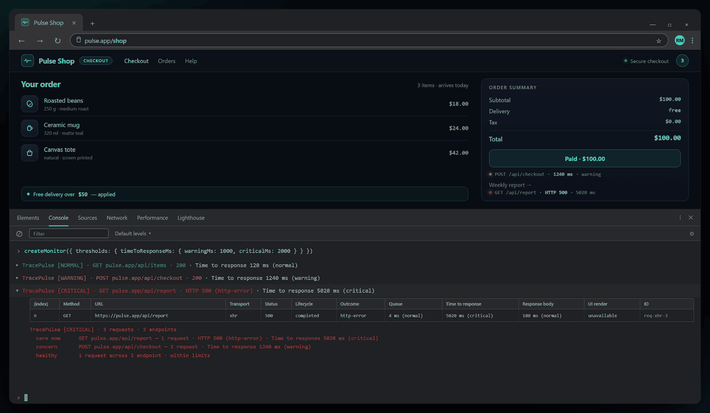

# TracePulse

<p align="center">
  
  
  
  
  
  
  
  
  
  
  
  
  
  
  
  
  
  
  
  
  
  
  
  
  
  
  
  
  
  
  
</p>

<div align="center">
  <h3>
    <a href="https://www.npmjs.com/package/@codewithrajat/tracepulse">View on npm</a>
    •
    <a href="https://github.com/malikrajat/tracepulse">Source Code</a>
    •
    <a href="https://stackblitz.com/edit/vitejs-vite-jt62srqb">Try Demo</a>
    •
    <a href="./docs/guide/getting-started.md">Documentation</a>
  </h3>
</div>

<div align="center">
  <p>
    <strong>Zero Dependencies</strong> ·
    <strong>Framework Agnostic</strong> ·
    <strong>High-Resolution Timing</strong> ·
    <strong>Type-Safe</strong> ·
    <strong>Production Ready</strong>
  </p>
</div>

## See It In Action

<div align="center">

  

</div>


## Table of Contents

- [Installation](./docs/guide/getting-started.md)
- [Quick Start / Usage](./docs/guide/getting-started.md)
- [API Reference](./docs/guide/api.md)
- [Configuration](./docs/guide/configuration.md)
- [Core Concepts](./docs/guide/core-concepts.md)
- [Architecture](./docs/guide/architecture.md)
- [Scope & Protocols](./docs/guide/scope.md)
- [Measurement Model](./docs/guide/measurement-model.md)
- [Plugins](./docs/guide/plugins.md)
- [Reporting](./docs/guide/reporting.md)
- [Performance Optimization](#performance-optimization)
- [Runtime Support](./docs/guide/architecture.md)
- [Migration & Versioning](./docs/guide/migration.md)
- [FAQ](#faq)
- [Troubleshooting](./docs/guide/troubleshooting.md)
- [Publishing](./docs/guide/publishing.md)
- [Project Structure](./docs/guide/architecture.md)
- [Changelog](./CHANGELOG.md)
- [License](./LICENSE)
- [Examples](./examples/README.md)


## Live Demo & Playground

| | |
| --- | --- |
| <a href="https://stackblitz.com/edit/vitejs-vite-jt62srqb" target="_blank"></a><br/><br/><sub><b>Interactive Playground</b></sub><br/><sub>Run it live in your browser — no install</sub> | <a href="./docs/index.md" target="_blank"></a><br/><br/><sub><b>Documentation Index</b></sub><br/><sub>Guides, API reference and internals</sub> |
| <a href="https://github.com/malikrajat/tracepulse/tree/main/examples" target="_blank"></a><br/><br/><sub><b>Complete Examples</b></sub><br/><sub>Copy-paste ready code samples</sub> | <a href="https://www.npmjs.com/package/@codewithrajat/tracepulse" target="_blank"></a><br/><br/><sub><b>npm Registry</b></sub><br/><sub>Install and view package details</sub> |
| <a href="https://github.com/malikrajat/tracepulse" target="_blank"></a><br/><br/><sub><b>Source Code</b></sub><br/><sub>Star, fork, and contribute</sub> | <a href="./docs/guide/architecture.md" target="_blank"></a><br/><br/><sub><b>Architecture &amp; Decisions</b></sub><br/><sub>How it works, and why it is shaped that way</sub> |


## Quick Start


`@codewithrajat/tracepulse` is a small, dependency-free request diagnostics toolkit for JavaScript and TypeScript. It wraps `fetch()` and `XMLHttpRequest`, measures every phase of the request lifecycle, classifies the result against warning and critical thresholds, and prints a readable report in the developer console — without an agent, a dashboard, a backend or an account. The same package also exposes a typed pulse/event primitive for timing your own application work, plus opt-in HTML and JSON report export.

It ships as ESM, CJS and IIFE, is safe to import on the server, and works in browsers, web workers, Node, Deno, Bun and edge runtimes.

### Installation

```bash
npm install @codewithrajat/tracepulse
```

### Basic Usage

```ts
import { createMonitor } from '@codewithrajat/tracepulse'

const monitor = createMonitor({
  exclude: ['/telemetry'],
  thresholds: {
    timeToResponseMs: { warningMs: 1000, criticalMs: 2000 }
  }
})

// Nothing else to wire: fetch() and XMLHttpRequest calls are observed from here on.
const response = await fetch('/api/orders')

monitor.stop() // uninstall this monitor's instrumentation
```

Open the console and you get one collapsed group per completed request, colour-coded by
severity, with a session summary that says which endpoint needs attention. No backend, no
upload, no account — the measurements never leave the page.

---

## Features

- **Automatic fetch instrumentation**: Wraps the global `fetch()` without changing its return value or rejection behaviour, and measures call, dispatch, resolution and failure boundaries
- **Automatic XHR instrumentation**: Patches `open`, `send` and `abort` with pass-through wrappers, preserves the native event model and removes listeners after every request settles
- **Four-phase timing**: Queue, time to response, response body and UI render, each reported separately so a slow request is never a single opaque number
- **Warning and critical thresholds**: Per-phase `{ warningMs, criticalMs }` pairs, validated at startup and tunable at runtime with `setThresholds()`
- **Colour-coded console reporting**: Collapsible groups, a one-line summary, healthy/warning/critical colours and an optional accumulated table or in-page panel
- **Session summary**: Groups by endpoint and answers "what needs attention" with `care now`, `concern`, `watch`, `not improving` and `healthy` sections
- **Slow-request detection**: Highlights timing growth over the previous sample of the same endpoint, with an arrow delta in the group header
- **Request exclusions**: Case-sensitive substring rules keep analytics, health checks and noisy third-party hosts out of the output
- **Typed event primitive**: `createTracePulse()` gives you pulses, bounded history, sampling, plugins and a typed emitter for your own measurements
- **HTML and JSON reports**: One call turns a session into a self-contained, searchable and sortable file; rendering is an opt-in subpath
- **Page timing**: Navigation, paint milestones, LCP and resource totals for one-off or continuous page measurement
- **Deterministic tests**: Inject `clock` and `idFactory`; no hidden globals, no flaky timestamps
- **Framework agnostic**: No React, Angular, Vue, Svelte, DOM or Node.js imports in the core
- **Runtime agnostic**: Browsers, workers, Node 18+, Deno, Bun and edge runtimes
- **Strict TypeScript**: `strict`, `noUncheckedIndexedAccess` and `exactOptionalPropertyTypes`, with stable error codes and validated runtime options
- **Zero dependencies**: `dependencies` is empty; the tarball contains only this library
- **Tiny and tree-shakable**: `sideEffects: false`, static ESM exports and a subpath split that keeps the report renderer out of the root bundle
- **Published package**: Dual ESM/CJS with `.d.ts` and `.d.cts`, an IIFE build for CDNs, publint/attw/size-limit gates and Changesets-based releases

---

## Quick Start Guide

### 1. Installation

Choose your preferred package manager:

```bash
# npm
npm install @codewithrajat/tracepulse

# pnpm
pnpm add @codewithrajat/tracepulse

# yarn
yarn add @codewithrajat/tracepulse

# bun
bun add @codewithrajat/tracepulse
```

### 2. Basic Integration

#### Option A: Automatic request monitoring (Recommended)

```ts
import { createMonitor } from '@codewithrajat/tracepulse'

const monitor = createMonitor({
  exclude: ['https://analytics.example.com', '/health'],
  thresholds: {
    queueMs: { warningMs: 100, criticalMs: 300 },
    timeToResponseMs: { warningMs: 2000, criticalMs: 3000 },
    responseProcessingMs: { warningMs: 300, criticalMs: 500 }
  },
  console: {
    level: 'all',
    panel: false
  }
})

// Every fetch() and XMLHttpRequest call is measured automatically.
```

`createMonitor()` starts immediately by default. Pass `autoStart: false` when you want to
install instrumentation only after your app has bootstrapped.

#### Option B: Core pulse instance (your own events)

`createTracePulse()` is the generic primitive: it records named pulses, keeps a bounded
history and dispatches typed events. It never patches a global.

```ts
import { createTracePulse } from '@codewithrajat/tracepulse'

const pulse = createTracePulse({ name: 'checkout', sampleRate: 0.5 })

const unsubscribe = pulse.on('pulse', (event) => {
  console.log(event.name, event.timestamp, event.data)
})

pulse.start()
pulse.pulse('render', { ms: 12 })

unsubscribe()
pulse.dispose()
```

| Entry point          | Use it for                                             | Installs globals? |
| -------------------- | ------------------------------------------------------ | ----------------- |
| `createMonitor()`    | Automatic fetch/XHR timing and console diagnostics     | Yes               |
| `createTracePulse()` | Your own application events, plugins and history       | No                |

### 3. Common Use Cases

#### Debugging a Slow API in a Single Page App

```ts
import { createMonitor } from '@codewithrajat/tracepulse'

const monitor = createMonitor({
  thresholds: {
    timeToResponseMs: { warningMs: 500, criticalMs: 1500 }
  },
  console: { onlyIssues: true }
})

// Later: a user reports a slow checkout, so drop the bar without a reload.
monitor.setThresholds({
  timeToResponseMs: { warningMs: 250, criticalMs: 800 }
})
```

`console.onlyIssues: true` hides healthy requests while keeping warnings, criticals, HTTP
errors, failures and near-limit entries — ideal when the console is otherwise busy.

#### Bootstrapping the Monitor in React

```tsx
import { useEffect } from 'react'
import { createMonitor } from '@codewithrajat/tracepulse'

export function useRequestMonitor(enabled: boolean): void {
  useEffect(() => {
    if (!enabled) {
      return
    }

    const monitor = createMonitor()

    return () => monitor.stop()
  }, [enabled])
}
```

The monitor owns no framework state. Create it where your application's lifecycle lives and
stop it on teardown; the [React](./examples/react/README.md),
[Angular](./examples/angular/README.md), [Vue](./examples/vue/README.md),
[Svelte](./examples/svelte/README.md) and [Node](./examples/node/README.md) folders contain
framework-specific recipes.

#### Timing Your Own Application Work

```ts
import { createTracePulse } from '@codewithrajat/tracepulse'

const pulse = createTracePulse({ name: 'dashboard' })

pulse.on('pulse', (event) => {
  if (event.name === 'hydrate' && Number(event.data?.ms) > 100) {
    console.warn('Hydration exceeded the budget', event.data)
  }
})

pulse.start()

const startedAt = performance.now()
// ... render the dashboard ...
pulse.pulse('hydrate', { ms: performance.now() - startedAt })
```

### 4. Advanced Configuration

```ts
import { createMonitor } from '@codewithrajat/tracepulse'

const monitor = createMonitor({
  enabled: true,
  autoStart: true,

  // Do not measure these URLs (case-sensitive substrings of the full URL).
  exclude: ['/telemetry', 'https://cdn.example.com'],

  // Every phase needs an explicit warning < critical pair.
  thresholds: {
    queueMs: { warningMs: 100, criticalMs: 300 },
    timeToResponseMs: { warningMs: 2000, criticalMs: 3000 },
    responseProcessingMs: { warningMs: 300, criticalMs: 500 },
    uiUpdateMs: { warningMs: 500, criticalMs: 1000 }
  },

  // Declare who owns a phase or a failure class. Nothing is guessed.
  ownership: {
    timeToResponseMs: 'platform-api',
    responseProcessingMs: 'content-service',
    serverError: 'platform-api',
    networkError: 'infrastructure'
  },

  colors: {
    normal: '#22c55e',
    warning: '#eab308',
    critical: '#ef4444'
  },

  console: {
    enabled: true,
    level: 'all',
    onlyIssues: false,
    useColors: true,
    showTable: true,
    collapsible: true,
    replace: false,
    panel: false
  },

  page: {
    enabled: true,
    mode: 'once',
    spa: false,
    settleMs: 300,
    resources: true,
    thresholds: {
      pageLoadMs: { warningMs: 3000, criticalMs: 5000 },
      firstContentfulPaintMs: { warningMs: 1800, criticalMs: 3000 },
      largestContentfulPaintMs: { warningMs: 2500, criticalMs: 4000 }
    }
  },

  report: { enabled: true, maxEntries: 500 }
})
```

Nested groups merge per property: override one threshold boundary and every other default is
preserved. Invalid types throw `TypeError`; negative or non-finite values, or a pair where
`warningMs` is not strictly less than `criticalMs`, throw `RangeError`.

### 5. Programmatic Control

```ts
import { createMonitor } from '@codewithrajat/tracepulse'

const monitor = createMonitor({ autoStart: false })

monitor.start() // install instrumentation (idempotent)
monitor.stop() // uninstall this monitor's wrappers (idempotent)

monitor.setThresholds({
  timeToResponseMs: { warningMs: 3000, criticalMs: 5000 }
})

const page = monitor.page() // PageLoadMeasurement | undefined
monitor.reportPage() // print the page timing report now

const snapshot = monitor.getReport({ generatedAt: Date.now() })
console.log(snapshot.measurements.length)

monitor.clearMeasurements() // empty the report store
```

A monitor may only run one instance per loaded module. A competing `start()` throws
`TracePulseError` with code `INVALID_STATE`; call `stop()` on the first monitor first.

### 6. Console Output & Reports

By default each terminal request is appended as one collapsed group. The header stays visible
and the timing row plus session summary expand on demand, so a busy console stays readable.

```text
▶ TracePulse [NORMAL] · GET pulse.app/api/items · 200 · Time to response 120 ms (normal)
▶ TracePulse [WARNING] · POST pulse.app/api/checkout · 200 · Time to response 1240 ms (warning)
▶ TracePulse [CRITICAL] · GET pulse.app/api/report · HTTP 500 (http-error) · Time to response 5020 ms (critical)
```

The expanded group contains the request row (`Method`, `URL`, `Transport`, `Status`,
`Lifecycle`, `Outcome`, `Queue`, `Time to response`, `Response body`, `UI render`, `ID`) and a
session summary grouped by endpoint:

```text
TracePulse [CRITICAL] · 3 requests · 3 endpoints
  care now      GET pulse.app/api/report — 1 request · HTTP 500 (http-error) · Time to response 5020 ms (critical)
  concern       POST pulse.app/api/checkout — 1 request · Time to response 1240 ms (warning)
  healthy       1 request across 1 endpoint · within limits
```

Need a live view without touching the console? Set `console.panel: true`:

```ts
createMonitor({ console: { panel: true } })
```

The reporter appends one collapsed overlay to the page and updates that same panel in place,
one row per request occurrence, with the session summary and page report inside. DevTools
cannot update a console entry in place, which is exactly the limitation this mode solves.

Need a file for a teammate, a ticket or a CI artefact? Export the bounded report:

```ts
import { createHtmlReport, downloadHtmlReport } from '@codewithrajat/tracepulse/report'

const html = createHtmlReport(monitor.getReport(), { title: 'Checkout latency' })
downloadHtmlReport(html, 'checkout-latency.html')
```

The HTML file is self-contained: inline CSS, server-rendered rows, and vanilla search/sort by
every timing metric. It names the flagged stage and its declared owner, includes page timing,
and binds no listener unless you call `installReportShortcut()`.

---

## Code Examples

Explore the recipes in [`examples/`](./examples/README.md). Every page is copy-paste ready:

| Example                                                     | Description                                                              | File                                                                               |
| ----------------------------------------------------------- | ------------------------------------------------------------------------ | ---------------------------------------------------------------------------------- |
| **Basic Monitoring**                                        | The smallest setup: one call, requests reported to the console           | [`examples/basic-monitoring.md`](./examples/basic-monitoring.md)                   |
| **Excluding Requests**                                      | Silence analytics, health checks and third-party hosts                   | [`examples/exclusions.md`](./examples/exclusions.md)                               |
| **Thresholds**                                              | Tune warning/critical boundaries per environment and per metric          | [`examples/thresholds.md`](./examples/thresholds.md)                               |
| **Console Output**                                          | Read the table and summary; colours, tables and "unavailable"            | [`examples/console-output.md`](./examples/console-output.md)                       |
| **Lifecycle Control**                                       | Deferred start, stop/restart, in-flight requests and the single-monitor rule | [`examples/lifecycle.md`](./examples/lifecycle.md)                             |
| **Core Events & Plugins**                                   | Pulses, history, sampling and plugin teardown                            | [`examples/core-events.md`](./examples/core-events.md)                             |
| **Testing**                                                 | Deterministic clocks, duration helpers and console assertions            | [`examples/testing.md`](./examples/testing.md)                                     |
| **SSR & Workers**                                           | Import safety, platform guards and per-request instances                 | [`examples/ssr.md`](./examples/ssr.md)                                             |
| **HTML & JSON Reports**                                     | Self-contained exports, retention, search/sort, owners and the shortcut  | [`examples/report-export.md`](./examples/report-export.md)                         |
| **React / Next.js**                                         | Context provider, StrictMode-safe instance, App Router guard             | [`examples/react/README.md`](./examples/react/README.md)                           |
| **Angular**                                                 | Root service, app initializer, `HttpClient`, zoneless and SSR            | [`examples/angular/README.md`](./examples/angular/README.md)                       |
| **Vue / Nuxt**                                              | Plugin install, composable, client-only guard                            | [`examples/vue/README.md`](./examples/vue/README.md)                               |
| **Svelte / SvelteKit**                                      | `onMount`, context, browser guard in a layout                            | [`examples/svelte/README.md`](./examples/svelte/README.md)                         |
| **Vanilla JS / TS**                                         | Module and IIFE `<script>` usage, Vite HMR                               | [`examples/vanilla/README.md`](./examples/vanilla/README.md)                       |
| **Node / Deno / Bun**                                       | Why process-wide monitoring is risky and how to scope it per request     | [`examples/node/README.md`](./examples/node/README.md)                             |

[View All Examples](./examples/README.md)

---

## 📖 Documentation

| Documentation                                                  | Description                                                     |
| -------------------------------------------------------------- | --------------------------------------------------------------- |
| **[Getting Started](./docs/guide/getting-started.md)**         | Install, first monitor, everyday commands                       |
| **[Configuration](./docs/guide/configuration.md)**             | Every setting, its default, merge rules and validation          |
| **[Architecture](./docs/guide/architecture.md)**               | Parameters, defaults, pipeline, build and licensing             |
| **[Scope & Protocols](./docs/guide/scope.md)**                 | In-scope transports, exclusions and open decisions              |
| **[API Reference](./docs/guide/api.md)**                       | Every export and signature                                      |
| **[Measurement Model](./docs/guide/measurement-model.md)**     | Timestamps, durations, lifecycle and outcomes                   |
| **[Core Concepts](./docs/guide/core-concepts.md)**             | Lifecycle, events, history, sampling and plugins                |
| **[Plugins](./docs/guide/plugins.md)**                         | Extend an instance without touching internals                   |
| **[Reporting](./docs/guide/reporting.md)**                     | Retention, report contents and privacy                          |
| **[Migration](./docs/guide/migration.md)**                     | Upgrade from single-number thresholds                           |
| **[Troubleshooting](./docs/guide/troubleshooting.md)**         | Common failures and their causes                                |

---

## Installation & Setup

For detailed installation instructions, see the
[Getting Started guide](./docs/guide/getting-started.md).

The package has no runtime dependencies. It does not require a bundler — an IIFE build is
available for a plain `<script>` tag:

```html
<script src="https://unpkg.com/@codewithrajat/tracepulse@1/dist/index.iife.global.js"></script>
<script>
  const monitor = TracePulse.createMonitor({ console: { panel: true } })
</script>
```

---

## Usage

For comprehensive usage examples and the full API, see the
[Usage guide](./docs/guide/getting-started.md) and the
[API reference](./docs/guide/api.md).

---

## Changelog

See [CHANGELOG.md](./CHANGELOG.md) for release history and updates.

---

### Latest Release

Check the [releases page](https://github.com/malikrajat/tracepulse/releases) for the most
recent version and changes.

---

## License

This project is licensed under the MIT License - see the [LICENSE](LICENSE) file for details.

**TL;DR:** You can use this library freely in commercial and personal projects.

### MIT License Summary

**You can:**

- Use commercially
- Modify the code
- Distribute
- Use privately

**You must:**

- Include the license and copyright notice

**You cannot:**

- Hold the author liable

---

## FAQ

<details>
<summary><strong>What exactly does TracePulse measure?</strong></summary>

It instruments `fetch()` and `XMLHttpRequest` and measures four non-overlapping phases:
**queue** (`queuedAt` → `sentAt`), **time to response** (`sentAt` → `responseStartedAt`),
**response body** (`responseStartedAt` → `responseCompletedAt`, XHR only) and **UI render**
(completion → an explicitly supplied UI mark). Each phase is compared against its own
warning/critical pair and rendered as one console group.

</details>

<details>
<summary><strong>Does it send data anywhere or need a backend?</strong></summary>

**No.** The package contains no endpoints, no account and no analytics. Requests are measured
in memory and printed locally. Exclusions filter only your application's own requests, and
response bodies, request bodies and sensitive headers are never stored.

</details>

<details>
<summary><strong>Which runtimes and frameworks are supported?</strong></summary>

The core is framework-agnostic and has no DOM or Node.js imports. It runs in modern browsers,
web workers, Node 18+, Deno, Bun and edge runtimes. React, Angular, Vue and Svelte need no
adapter package — you own the lifecycle; copy-paste recipes live in
[`examples/`](./examples/README.md).

</details>

<details>
<summary><strong>Is it safe to import during server-side rendering?</strong></summary>

**Yes.** Importing has no side effects and touches no globals. Creating a **monitor** is the
part that patches the realm's global `fetch`, so guard it to the browser. On the server, use
`createTracePulse()` per request instead. See [SSR and workers](./examples/ssr.md).

</details>

<details>
<summary><strong>How do I stop it from measuring analytics or health checks?</strong></summary>

Add case-sensitive substrings of the full URL to `exclude`:

```ts
createMonitor({
  exclude: ['/telemetry', 'https://analytics.example.com', '/health']
})
```

Matching requests are still executed normally; they are simply not observed.

</details>

<details>
<summary><strong>How do I customise the thresholds?</strong></summary>

Every phase takes an explicit pair:

```ts
createMonitor({
  thresholds: {
    timeToResponseMs: { warningMs: 1000, criticalMs: 2000 },
    responseProcessingMs: { warningMs: 300, criticalMs: 500 }
  }
})
```

Nested groups merge per property, so untouched phases keep their defaults. Boundaries can be
changed later with `monitor.setThresholds()`, even while the monitor is running.

</details>

<details>
<summary><strong>Why is "Response body" always <code>unavailable</code> for fetch?</strong></summary>

`fetch()` resolves when headers arrive, and TracePulse deliberately never reads or clones the
body just to time it. `XMLHttpRequest` exposes a completion event, so the interval is available
there. The full download time is intentionally not part of the observed fetch lifecycle.

</details>

<details>
<summary><strong>Why does <code>uiUpdateMs</code> never produce a value?</strong></summary>

No transport populates `uiTiming`, and V1 exposes no API to supply it. The threshold defines
boundaries for a measurement point that does not exist yet, so tuning it changes nothing.

</details>

<details>
<summary><strong>Can I see the report without reading the console?</strong></summary>

**Yes.** Set `console.panel: true` for a collapsed in-page panel that updates in place, or
export a self-contained HTML/JSON file with `createHtmlReport()` / `createJsonReport()` from
`@codewithrajat/tracepulse/report`. Reports are built entirely locally.

</details>

<details>
<summary><strong>How large is the package, and will it bloat my bundle?</strong></summary>

The root entry is a minified ESM build with `sideEffects: false` and static exports, so unused
modules are tree-shaken away. A size-limit gate keeps the published root bundle under 17 kB
brotli. The HTML/JSON renderer lives on an opt-in subpath, so applications that never export a
report pay nothing for it.

</details>

<details>
<summary><strong>Does <code>stop()</code> cancel in-flight requests?</strong></summary>

**No.** Requests keep their original results and XHR keeps its native lifecycle. TracePulse
only stops observing: no terminal report is produced after `stop()`, and no synthetic
"aborted" entry is invented.

</details>

<details>
<summary><strong>Why do I get two reports per request after a hot reload?</strong></summary>

A hot reload can create a second module instance with a second monitor, and both wrap
`fetch`. Stop the previous monitor in `import.meta.hot.dispose()` — see the
[HMR guard](./examples/basic-monitoring.md).

</details>

<details>
<summary><strong>Why does creating a second monitor throw <code>INVALID_STATE</code>?</strong></summary>

V1 allows one running monitor per loaded module instance. Call `stop()` on the first monitor
before starting another, and keep a single monitoring module per application. Separate copies
of the package or separate JavaScript realms are not globally coordinated.

</details>

<details>
<summary><strong>Can I use it with axios or TanStack Query?</strong></summary>

In the browser those libraries ultimately use `fetch` or `XMLHttpRequest`, so their requests
are observed like any other. Node HTTP clients that bypass those globals (for example axios in
Node, which uses the `http` module) are outside the V1 scope. See
[Scope & Protocols](./docs/guide/scope.md).

</details>

<details>
<summary><strong>Is this library free for commercial use?</strong></summary>

**Yes.** Licensed under **MIT** — use it in commercial products, SaaS applications and
enterprise projects. You only need to retain the copyright notice. See the
[License](#license) section.

</details>

---

## Performance Optimization

### Optimization Tips

#### 1. Create the Monitor Once at Bootstrap

```ts
import { createMonitor } from '@codewithrajat/tracepulse'

// One monitor for the application, not one per component or per request.
const monitor = createMonitor({ autoStart: true })
```

Repeated `start()` calls are idempotent, so there is no reason to create a second monitor for
each feature module.

#### 2. Exclude Noise Before It Reaches the Reporter

```ts
createMonitor({
  exclude: ['/telemetry', '/health', '/metrics', 'https://cdn.example.com']
})
```

Exclusions are checked before a measurement is produced, which keeps both the console and the
bounded report store focused on the requests you actually care about.

#### 3. Tune the Console for Production

```ts
createMonitor({
  console: {
    level: 'warning', // hide healthy requests
    onlyIssues: false,
    showTable: true,
    collapsible: true
  }
})
```

`level` is a severity floor (`all`, `warning`, `critical`, `off`). `onlyIssues` is a separate
pass/fail switch that hides green entries while keeping warnings, criticals, HTTP errors and
near-limit (`watch`) entries. A build can choose the default floor with
`TRACEPULSE_LOG_LEVEL`.

#### 4. Cap Retained Report Data

```ts
createMonitor({ report: { enabled: true, maxEntries: 200 } })
```

The report store is bounded; oldest measurements are dropped first. `maxEntries: 0` retains
nothing while console reporting keeps working.

#### 5. Keep the Renderer Out of the Root Bundle

```ts
import { createMonitor } from '@codewithrajat/tracepulse'
// No import from '@codewithrajat/tracepulse/report' unless you actually export.
```

The report subpath is a separate entry point, so search/sort UI and HTML/JSON rendering are
tree-shaken from applications that never export.

---

## Testing Examples

### Unit Testing with Vitest

```ts
import { afterEach, describe, expect, it, vi } from 'vitest'
import { createMonitor } from '@codewithrajat/tracepulse'

const originalFetch = globalThis.fetch

afterEach(() => {
  globalThis.fetch = originalFetch
  vi.restoreAllMocks()
})

describe('TracePulse monitor', () => {
  it('observes a request and preserves the original response', async () => {
    const monitor = createMonitor({
      autoStart: false,
      console: { enabled: false }
    })

    const response = new Response('{"ok":true}', {
      status: 200,
      headers: { 'content-type': 'application/json' }
    })

    globalThis.fetch = vi.fn().mockResolvedValue(response)

    monitor.start()
    const result = await fetch('/api/items')
    monitor.stop()

    expect(result).toBe(response)
    expect(monitor.getReport().measurements).toHaveLength(1)
  })
})
```

For deterministic pulse tests, inject the clock and the id factory:

```ts
import { createTracePulse } from '@codewithrajat/tracepulse'

const pulse = createTracePulse({
  clock: () => 1_000,
  idFactory: () => 'id-1'
})
```

### End-to-End Testing with Playwright

```ts
import { test, expect } from '@playwright/test'

test('reports a request in the console', async ({ page }) => {
  const messages: string[] = []

  page.on('console', (message) => messages.push(message.text()))

  await page.goto('/checkout')
  await page.getByRole('button', { name: 'Load items' }).click()

  await expect.poll(() => messages.join('\n')).toContain('TracePulse')
})
```

The workspace runs its unit suite with **Vitest** through Vite+, and the optional browser smoke
test uses real Chromium. See [`examples/testing.md`](./examples/testing.md) for console
assertions and duration-helper tests.

---

## Migration Guide

### From Manual Timing Code

| Manual approach                                   | TracePulse                                                     |
| ------------------------------------------------- | -------------------------------------------------------------- |
| `performance.now()` before and after `fetch()`    | `monitor.getReport()` — phases already separated               |
| `console.time()` / `console.timeEnd()`            | Automatic console group per request                            |
| `Date.now()` arithmetic around XHR                | `getRequestDurations(timing)` with a single monotonic clock    |
| Hand-written slow-request `if` statements         | `thresholds` with explicit warning/critical pairs              |
| A custom table printed after every request        | Collapsible groups, session summary or the in-place panel      |
| Ad-hoc metrics uploaded to a backend              | Local HTML/JSON report; nothing leaves the page by default     |

### From a Browser APM SDK

| APM SDK concept                     | TracePulse                                             |
| ----------------------------------- | ------------------------------------------------------ |
| Global agent / auto-init script     | `createMonitor()` — one import, no agent               |
| Backend ingestion endpoint          | None; local console and files only                     |
| Custom dashboards                   | Session summary plus self-contained HTML/JSON reports  |
| Per-request transaction timing      | Queue, time to response, response body and UI render   |
| Sampling and unlimited retention    | Bounded `report.maxEntries`, optional core `sampleRate` |

### From Single-Number Thresholds (pre-1.0 dev builds)

Early builds accepted one number per category. 1.0.0 requires an explicit pair, and
`requestDurationMs` is now `timeToResponseMs`:

```ts
// Before (rejected)
thresholds: { requestDurationMs: 3000 }

// After (valid)
thresholds: {
  timeToResponseMs: { warningMs: 2000, criticalMs: 3000 }
}
```

The old key and numeric form are rejected, not reinterpreted. See the
[threshold pairs guide](./docs/guide/migration.md).

---

## Troubleshooting

### Common Issues

#### Issue: nothing appears in the console

```ts
// Check the chain in order:
const monitor = createMonitor({
  enabled: true, // not false
  autoStart: true, // or call monitor.start() yourself
  exclude: [], // the request was not filtered out
  console: {
    enabled: true,
    level: 'all' // 'warning' hides healthy requests, 'off' hides everything
  }
})
```

The reporter prints nothing for in-flight requests — the request must reach a terminal state.

#### Issue: `INVALID_STATE` when starting a monitor

```ts
const first = createMonitor()
// const second = createMonitor() // a second start would throw while first is running

first.stop()
const second = createMonitor() // safe now
```

The same code is also used after `dispose()` on the core instance, which is terminal — create a
new instance instead of reusing a disposed one.

#### Issue: duplicate reports after editing a file

```ts
if (import.meta.hot) {
  import.meta.hot.dispose(() => monitor.stop())
}
```

A hot reload created a second module instance; stopping the previous monitor removes the
duplicate wrapper.

#### Issue: "Response body" or "UI render" shows `unavailable`

They are genuinely not observed: fetch does not consume the body, and V1 has no API to supply
a UI mark. Unavailable phases are never rendered as `0` or `normal`.

#### Issue: monitoring does nothing in Node

`createMonitor()` patches the realm's global `fetch`. If your Node code uses a client that
bypasses global fetch/XHR, TracePulse cannot see it. Use `createTracePulse()` for your own
timings, or install a fetch-based client. See [Node](./examples/node/README.md).

---

## API Reference Quick Start

### Inputs

`createMonitor(config?)` accepts a partial `MonitorConfigInput`. Nested groups merge per
property.

| Setting                 | Type                                                | Default                                            | Description                                                           |
| ----------------------- | --------------------------------------------------- | -------------------------------------------------- | --------------------------------------------------------------------- |
| `enabled`               | `boolean`                                           | `true`                                             | When `false`, the monitor never starts; fixed at creation             |
| `autoStart`             | `boolean`                                           | `true`                                             | Installs instrumentation immediately                                  |
| `exclude`               | `string[]`                                          | `[]`                                               | Case-sensitive substrings of the full request URL                     |
| `thresholds.queueMs`    | `{ warningMs, criticalMs }`                         | `100 / 300`                                        | Wait before dispatch                                                  |
| `thresholds.timeToResponseMs` | `{ warningMs, criticalMs }`                   | `2000 / 3000`                                      | Dispatch → headers                                                    |
| `thresholds.responseProcessingMs` | `{ warningMs, criticalMs }`               | `300 / 500`                                        | Headers → transport completion                                        |
| `thresholds.uiUpdateMs` | `{ warningMs, criticalMs }`                         | `500 / 1000`                                       | Completion → explicit UI mark                                          |
| `ownership`             | `Record<string, string>`                            | `{}`                                               | Declared owner labels per phase and failure class                     |
| `colors`                | `{ normal, warning, critical }`                     | `#22c55e / #eab308 / #ef4444`                      | Console colours                                                       |
| `console.enabled`       | `boolean`                                           | `true`                                             | Turn console reporting on or off                                      |
| `console.level`         | `"all" \| "warning" \| "critical" \| "off"`         | `"all"`                                            | Minimum severity to print                                             |
| `console.onlyIssues`    | `boolean`                                           | `false`                                            | Hide healthy entries, keep every issue and near-limit entry           |
| `console.useColors`     | `boolean`                                           | `true`                                             | Colour-coded output                                                   |
| `console.showTable`     | `boolean`                                           | `true`                                             | Include the request table                                             |
| `console.collapsible`   | `boolean`                                           | `true`                                             | One collapsed group per request vs a plain header line                |
| `console.replace`       | `boolean`                                           | `false`                                            | Clear and redraw one accumulated table (also clears app output)       |
| `console.panel`         | `boolean`                                           | `false`                                            | Render an in-page overlay updated in place                            |
| `page`                  | `PageConfig`                                        | `once`, `settleMs: 300`, resources on              | Navigation, paint, LCP and resource timing                            |
| `report`                | `{ enabled, maxEntries }`                           | `true / 500`                                       | Bounded store behind `getReport()`                                    |

### Outputs

| Output                              | Kind                  | Description                                                              |
| ----------------------------------- | --------------------- | ------------------------------------------------------------------------ |
| Console groups                      | Reporter              | One collapsed group per terminal request plus the session summary        |
| In-page panel                       | Reporter (`console.panel`) | Collapsed overlay with one row per request occurrence               |
| `monitor.getReport()`               | `TracePulseReport`    | Frozen raw snapshot of retained measurements and settings                |
| `createHtmlReport(snapshot)`        | `string`              | Self-contained HTML with inline CSS and search/sort                      |
| `createJsonReport(snapshot)`        | `string`              | Classified report view as JSON                                           |
| `createReportView(snapshot)`        | Object                | Classified entries, severities, stages, owners and rollups               |
| `downloadHtmlReport(html, name?)`   | DOM helper            | Blob + `<a download>`; explicit call only                                |
| `installReportShortcut(monitor)`    | DOM helper            | Opt-in `Ctrl/Cmd+Shift+E` export; returns an unsubscribe                 |
| `pulse`, `start`, `stop`, `error`, `dispose` | Core events  | Typed events from `createTracePulse()`                                   |

### Methods

| Method                              | Owner     | Returns                    | Description                                              |
| ----------------------------------- | --------- | -------------------------- | -------------------------------------------------------- |
| `start()`                           | `Monitor` | `this`                     | Install instrumentation (idempotent)                     |
| `stop()`                            | `Monitor` | `this`                     | Uninstall this monitor's wrappers (idempotent)           |
| `page()`                            | `Monitor` | `PageLoadMeasurement \| undefined` | Latest page measurement                          |
| `reportPage()`                      | `Monitor` | `this`                     | Print the page timing report                             |
| `setThresholds(thresholds)`         | `Monitor` | `this`                     | Merge request threshold overrides at runtime            |
| `getReport(options?)`               | `Monitor` | `TracePulseReport`         | Raw retained-measurement snapshot                       |
| `clearMeasurements()`               | `Monitor` | `this`                     | Empty the report store                                  |
| `pulse(name, data?)`                | `TracePulse` | `void`                  | Record a named pulse                                     |
| `on(event, listener)`               | `TracePulse` | `Unsubscribe`           | Subscribe to a typed event                               |
| `use(plugin)`                       | `TracePulse` | `this`                  | Register a plugin                                        |
| `dispose()`                         | `TracePulse` | `void`                  | Terminal cleanup; listeners and plugins are released     |

Full reference: **[docs/guide/api.md](./docs/guide/api.md)**.

---

## Best Practices

### 1. Create One Monitor per Application

```ts
// bootstrap.ts
import { createMonitor } from '@codewithrajat/tracepulse'

export const monitor = createMonitor()
```

Framework providers, hooks or services can import the same instance instead of creating a new
one. Store it where your app owns teardown and call `stop()` there.

### 2. Guard Browser-Only Work on the Server

```ts
const isBrowser = typeof window !== 'undefined'

export const monitor = isBrowser ? createMonitor() : undefined
```

Importing is always safe; patching globals is not. Use `createTracePulse()` per request on the
server.

### 3. Tune for the Environment

```ts
createMonitor({
  console: { level: import.meta.env.PROD ? 'warning' : 'all' },
  thresholds: {
    timeToResponseMs: { warningMs: 2000, criticalMs: 3000 }
  }
})
```

Keep full output in development and raise the severity floor in production, or choose the
default at build time with `TRACEPULSE_LOG_LEVEL`.

### 4. Declare Ownership Instead of Guessing

```ts
createMonitor({
  ownership: {
    timeToResponseMs: 'platform-api',
    responseProcessingMs: 'content-service',
    serverError: 'platform-api'
  }
})
```

Reports only name a team when the application declared the mapping; TracePulse never infers
an owner.

---

## Documentation

- **[Getting Started](./docs/guide/getting-started.md)** - Install, first monitor, everyday commands
- **[Configuration](./docs/guide/configuration.md)** - Every setting, default, merge rule and validation
- **[Architecture](./docs/guide/architecture.md)** - Parameters, defaults, pipeline, build and licensing
- **[Scope & Protocols](./docs/guide/scope.md)** - In-scope transports, exclusions and open decisions
- **[API Reference](./docs/guide/api.md)** - Every export and signature
- **[Measurement Model](./docs/guide/measurement-model.md)** - Timestamps, durations, lifecycle and outcomes
- **[Core Concepts](./docs/guide/core-concepts.md)** - Lifecycle, events, history, sampling and plugins
- **[Plugins](./docs/guide/plugins.md)** - Extend an instance without touching internals
- **[Reporting](./docs/guide/reporting.md)** - Retention, report contents and privacy
- **[Migration](./docs/guide/migration.md)** - Upgrade from single-number thresholds
- **[Troubleshooting](./docs/guide/troubleshooting.md)** - Common failures and their causes

---

## Statistics

[](https://www.npmjs.com/package/@codewithrajat/tracepulse)
[](https://github.com/malikrajat/tracepulse/issues)
[](https://github.com/malikrajat/tracepulse/stargazers)
[](https://github.com/malikrajat/tracepulse/blob/main/LICENSE)

---

## Support This Project

If **TracePulse** has helped you build better JavaScript applications, please consider:

If this library has saved you development time and helped make request performance visible in your projects, **please consider giving it a star!**

**Why star this repo?**

- Help other developers discover this lightweight, optimized solution
- Support continued development and improvements
- Show appreciation for free, quality tools
- Boost visibility in the JavaScript community
- Supports ongoing development and maintenance
- Encourages more open-source contributions
- Helps other developers find quality tools

### **Want More Quality Libraries?**

This is just one of several useful libraries I've created. **[Explore my other JavaScript & web development libraries](https://github.com/malikrajat?tab=repositories)** that might solve your next challenge:

- **Utility libraries** for common development tasks
- **UI components** for better user experiences
- **Performance tools** for optimization
- **Mobile-friendly solutions** for responsive apps

**Found them helpful?** A star on each repo you find useful helps tremendously! It takes just one click but means the world to open-source maintainers.

[](https://github.com/malikrajat?tab=repositories)
[](https://github.com/malikrajat)
[](https://github.com/malikrajat/tracepulse/stargazers)

---

## Support and Community

### Getting Help

Need assistance? We're here to help!

| Support Channel | Link | Best For |
|----------------|------|----------|
| Bug Reports | [Report Bug](https://github.com/malikrajat/tracepulse/issues/new?template=bug_report.md) | Technical issues |
| Feature Requests | [Request Feature](https://github.com/malikrajat/tracepulse/issues/new?template=feature_request.md) | New features |
| Discussions | [Join Discussion](https://github.com/malikrajat/tracepulse/discussions) | General questions |
| Email | [support@rajatmalik.dev](mailto:support@rajatmalik.dev?subject=TracePulse%20Support) | Direct support |

### Documentation

- [GitHub Repository](https://github.com/malikrajat/tracepulse)
- [npm Package](https://www.npmjs.com/package/@codewithrajat/tracepulse)
- [Live Demo](https://stackblitz.com/edit/vitejs-vite-jt62srqb)
- [Changelog](https://github.com/malikrajat/tracepulse/blob/main/CHANGELOG.md)
- [Support Guide](./SUPPORT.md)

### Community

- Star the repository to show support
- Watch for updates and new releases
- Share your use cases and feedback
- Contribute code, examples or documentation

### Stay Updated

- Follow the project on [GitHub](https://github.com/malikrajat/tracepulse)
- Star the repository for updates
- Watch for new releases

---

## Acknowledgements

This library was built to make request performance visible without adding a vendor, an agent or
a network hop.

Special thanks to:

- **The JavaScript community** — for the standards, tooling and feedback that shaped this API
- **Contributors** — for making the library better with every issue and pull request
- **Everyone debugging in a console** — for reminding us that the fastest observability tool is
  the one already open

---

## Other Libraries

### Monitoring & Diagnostics

| Library | Description | Link |
| --- | --- | --- |
| **@codewithrajat/rm-logvault** | Offline-first browser error tracking, logging and one-file diagnostics export. Redacts PII before writing, stores in IndexedDB, uploads only to your own endpoint. **Zero dependencies, tree-shakeable, framework-agnostic** — React, Vue, Angular, axios and TanStack Query adapters included. | [](https://www.npmjs.com/package/@codewithrajat/rm-logvault) |
| **@codewithrajat/tracepulse** | Zero-dependency API request monitoring, timing and performance observability. Instruments `fetch()` and XHR automatically, measures queue, time-to-response, response-body and UI-render phases, classifies warning/critical thresholds and prints colour-coded console reports or self-contained HTML/JSON exports — no backend, agent or account. **Zero dependencies, tree-shakeable, framework-agnostic** — React, Angular, Vue, Svelte, Node and edge-runtime recipes included. | [](https://www.npmjs.com/package/@codewithrajat/tracepulse) |
| **@codewithrajat/runtime-debug-panel** | Framework-independent runtime monitoring and diagnostics for browser JavaScript. Samples memory, performance and long-task metrics on a bounded schedule, detects runtime capabilities, and ships a Lit floating developer panel plus uPlot chart contracts through explicit, side-effect-free entry points. **Tree-shakeable ESM, zero framework lock-in** — works in vanilla, React, Vue and Angular apps.   | [](https://www.npmjs.com/package/@codewithrajat/runtime-debug-panel)   |
---

### UI Components

| Library                           | Description                                                              | npm Link                                                                                                        |
| --------------------------------- | ------------------------------------------------------------------------ | --------------------------------------------------------------------------------------------------------------- |
| **rm-range-slider**               | Lightweight two-thumb range slider with tooltips and color customization | [](https://www.npmjs.com/package/rm-range-slider)       |
| **rm-ng-range-slider**            | Angular-specific version of the dual range slider                        | [](https://www.npmjs.com/package/rm-ng-range-slider) |
| **rm-carousel**                   | Simple, responsive carousel component                                    | [](https://www.npmjs.com/package/rm-carousel)               |
| **rm-image-slider**               | Minimal image slider with smooth transitions                             | [](https://www.npmjs.com/package/rm-image-slider)       |
| **rm-ng-star-rating**             | Configurable Angular star rating component with readonly mode            | [](https://www.npmjs.com/package/rm-ng-star-rating)   |
| **@codewithrajat/rm-ng-typeahead** | Angular autocomplete/typeahead component with search suggestions and keyboard navigation | [](https://www.npmjs.com/package/@codewithrajat/rm-ng-typeahead)   |
| **@codewithrajat/rm-ng-editor**    | Rich text editor component for Angular applications with customizable toolbar support | [](https://www.npmjs.com/package/@codewithrajat/rm-ng-editor)   |
| **@codewithrajat/rm-ng-drop**                    | Angular  drag-and-drop file upload and selection toolkit: drop zone, file preview and a searchable single/multi-select dropdown with chips, async sources and CDK virtual scroll. Built on signals, zone-less, standalone and reactive-form ready. | [](https://www.npmjs.com/package/@codewithrajat/rm-ng-drop)   |
---

### Documents & Media

| Library | Description | npm Link |
| --- | --- | --- |
| **@codewithrajat/universal-document-viewer** | Browser-first, framework-agnostic document viewer for PDF, Office, OpenDocument, e-books, images, CSV, JSON and 25+ formats. One ESM package with 27 explicit subpaths, a headless core, lazily loaded engines, optional UI, search, OCR, annotations and signature verification, plus React, Vue, Angular and vanilla integrations. **Privacy-first: documents render locally and nothing is uploaded.**   | [](https://www.npmjs.com/package/@codewithrajat/universal-document-viewer)   |
| **@codewithrajat/universal-player** | Framework-agnostic universal media player for video, audio, images, HLS, DASH and YouTube/Vimeo embeds. One headless TypeScript core, a `<universal-player>` web component with custom controls, chapters, playlists, thumbnails, captions and in-player surveys, plus React, Vue, Angular, Svelte 4 and Svelte 5 adapters. **Tree-shakeable, custom-element first and dependency-free at the core.**   | [](https://www.npmjs.com/package/@codewithrajat/universal-player)   |

---

### PDF & Export Libraries

| Library                                | Description                                                  | npm Link                                                                                                                                        |
| -------------------------------------- | ------------------------------------------------------------ | ----------------------------------------------------------------------------------------------------------------------------------------------- |
| **rm-ng-export-to-csv**                | Export JSON data to CSV with zero dependencies               | [](https://www.npmjs.com/package/rm-ng-export-to-csv)                               |
| **@codewithrajat/rm-ng-pdf-export**    | Image-based PDF export tool for Angular applications         | [](https://www.npmjs.com/package/@codewithrajat/rm-ng-pdf-export)       |
| **@codewithrajat/rm-ng-structure-pdf** | Generate structured PDFs for reports, invoices, or documents | [](https://www.npmjs.com/package/@codewithrajat/rm-ng-structure-pdf) |
| **@codewithrajat/rm-ng-pdf-viewer**    | Angular PDF viewer component with zoom, navigation, and document rendering support | [](https://www.npmjs.com/package/@codewithrajat/rm-ng-pdf-viewer) |

---

### Chrome Extension

| Library | Description | Link |
| --- | --- | --- |
| **quickocr** | Chrome extension that extracts text from images using OCR technology | [](https://github.com/malikrajat/quickocr/releases) |
| **readLoude** | Chrome extension that reads web pages aloud, e.g. articles | [](https://github.com/malikrajat/readLoude/releases) |
| **ai-assistant-reply** | AI Chrome extension to auto-generate replies on LinkedIn posts | [](https://github.com/malikrajat/ai-assistant-reply/releases) |

---

### VS Code Extension

| Library | Description | Link |
| --- | --- | --- |
| **dead-css-cleaner** | VS Code extension for identifying and cleaning unused CSS styles | [](https://marketplace.visualstudio.com/items?itemName=RajatMalik.dead-css-cleaner) [](https://github.com/malikrajat/dead-css-cleaner/releases) |
| **file-coverage-insight** | VS Code extension for automatically generated component file coverage on open | [](https://marketplace.visualstudio.com/items?itemName=RajatMalik.file-coverage-insight) [](https://github.com/malikrajat/file-coverage-insight/releases) |
| **npmDepScript** | Run npm scripts and review outdated, deprecated and vulnerable dependencies without leaving VS Code | [](https://marketplace.visualstudio.com/items?itemName=RajatMalik.npm-dep-script) [](https://github.com/malikrajat/npmDepScript) |

---

### Desktop Applications - All Platforms

| Library | Description | Link |
| --- | --- | --- |
| **deepwork** | Cross-platform productivity application for focus sessions and deep work tracking | [](https://deepwork.rajatmalik.dev/) [](https://app.deepwork.rajatmalik.dev/) [](https://github.com/malikrajat/deepwork/releases) |
| **JsSandbox** | Cross-platform JavaScript playground and code execution environment | [](https://github.com/malikrajat/JsSandbox/releases) |

---

### Device Detection

| Library                    | Description                                    | npm Link                                                                                                                        |
| -------------------------- | ---------------------------------------------- | ------------------------------------------------------------------------------------------------------------------------------- |
| **rm-ng-device-detection** | Detect device type, OS, and browser in Angular | [](https://www.npmjs.com/package/rm-ng-device-detection)         |

---

### Notifications

| Library | Description | npm Link |
| --- | --- | --- |
| **rm-pushnotify** | Lightweight push-style toast notification utility | [](https://www.npmjs.com/package/rm-pushnotify) |
| **@codewithrajat/rm-toast-notification** | Cross-platform toast and desktop notification library for web, Angular, and desktop applications | [](https://www.npmjs.com/package/@codewithrajat/rm-toast-notification) |

---

### Layout & Dynamic Rendering

| Library | Description | Link |
| --- | --- | --- |
| **@codewithrajat/rm-ng-dynamic-layout** | Dynamic layout rendering engine for Angular applications using JSON-driven UI configuration | [](https://www.npmjs.com/package/@codewithrajat/rm-ng-dynamic-layout) |

---

### Developer Tools & Extensions

| Library | Description | npm Link |
| --- | --- | --- |
| **rm-colorful-console-logger** | Structured and colorized console logging utility for developers | [](https://www.npmjs.com/package/rm-colorful-console-logger) |

---

### Meta & Personal Branding

| Library | Description | npm Link |
| --- | --- | --- |
| **about-rajat** | Developer portfolio package for branding and quick personal info | [](https://www.npmjs.com/package/about-rajat) |

---

### Websites & Live Products

| Website | Description | Link |
| --- | --- | --- |
| **rajatmalik.dev** | Personal portfolio and engineering site: role fit, skills, 15+ years of experience, 30+ open-source libraries and tools, talks, selected product work and 150+ technical articles. Hand-written HTML and CSS with **no framework and no build step**, published from GitHub Pages with structured data and plain-text profiles for search engines and AI assistants. | [](https://rajatmalik.dev/) |
| **dailymilk.rajatmalik.dev** | **DailyMilk** — free, installable dairy operations PWA for milk delivery businesses. Tracks milkmen, daily milk entries, milk rates and price lists, purchases and customer payments, then turns them into CSV and PDF reports, with full JSON database export/import and offline support. Built with an **Angular signals** dashboard and Firebase auth/storage; installable on Android, iOS, Windows, macOS and Linux. | [](https://dailymilk.rajatmalik.dev/) |
| **rent.rajatmalik.dev** | **Rents Collections** — a calm, secure workspace for landlords and property managers to keep tenancies, rent schedules and payment reminders in one place instead of scattered across spreadsheets and notes. Responsive React interface with a dark, focused UI. | [](https://rent.rajatmalik.dev/) |

---

### All Packages

Browse all my packages:

- [npm: @codewithrajat](https://www.npmjs.com/~codewithrajat)
- [npm: rajatmalik](https://www.npmjs.com/~rajatmalik)
- [GitHub: @malikrajat](https://github.com/malikrajat?tab=repositories)

---

## Author

**Rajat Malik**

Full-Stack Developer and Frontend Architect at Siemens with 14+ years building scalable enterprise platforms, specializing in micro-frontends, AI-native development, React, and Angular.
Author of 10+ open-source libraries and 100+ technical articles, driving innovation through developer-friendly tools, performance optimization, and AI-assisted workflows.

### GET IN TOUCH

- Portfolio:  [rajatmalik.dev](https://rajatmalik.dev)
- Email:      [support@rajatmalik.dev](mailto:support@rajatmalik.dev)
- LinkedIn:   [errajatmalik](https://linkedin.com/in/errajatmalik)
- GitHub:     [@malikrajat](https://github.com/malikrajat)
- npm:        [rajatmalik](https://www.npmjs.com/~rajatmalik)

### SOCIAL PRESENCE

- Threads:    [rajatmalik](https://www.threads.net/@er.rajatmalik)
- Twitter/X:  [rajatmalik](https://x.com/er_rajatmalik)
- BlueSky:    [rajatmalik](http://devrajat.bsky.social)

### CONTENT & WRITING

- Medium:    [rajatmalik](https://medium.com/@codewithrajat)
- Dev.to:    [rajatmalik](https://dev.to/codewithrajat)
- Substack:   [rajatmalik](https://codewithrajat.substack.com)
- Hashnode:   [rajatmalik](https://hashnode.com/@codeswithrajat)

---

<p align="center">
  Made with care and love by <a href="https://rajatmalik.dev">Rajat Malik</a> for the JavaScript community
</p>

<p align="center">
  <a href="https://github.com/malikrajat/tracepulse/stargazers">Star on GitHub</a> •
  <a href="https://www.npmjs.com/package/@codewithrajat/tracepulse">View on npm</a> •
  <a href="https://github.com/malikrajat/tracepulse/issues">Report Issue</a> •
  <a href="https://stackblitz.com/edit/vitejs-vite-jt62srqb">Try Demo</a>
</p>

<p align="center">
  Made with dedication by <a href="https://rajatmalik.dev">Rajat Malik</a>
</p>
